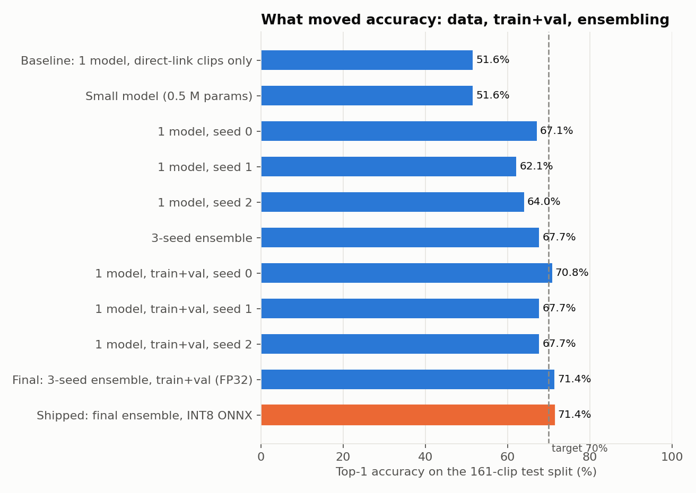
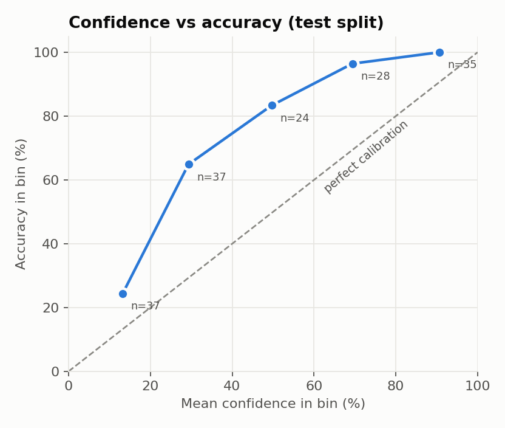
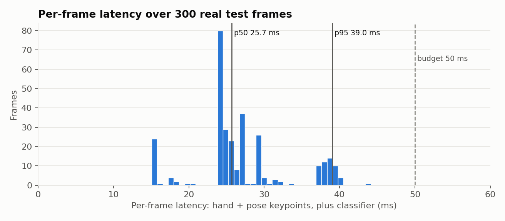
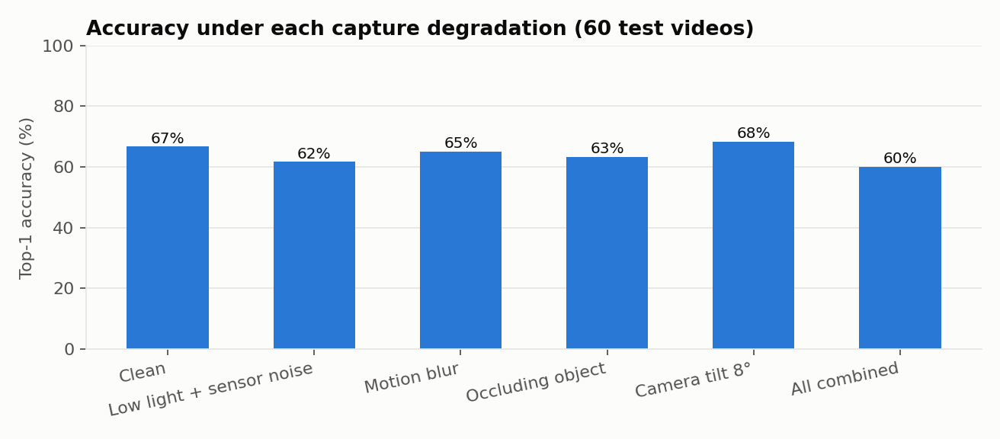

# EchoGesture benchmark report

Team Hypervisor · SRMIST · XR Hackathon 2026, Track 2. All numbers below come from running
[`scripts/benchmark.py`](scripts/benchmark.py) and [`scripts/benchmark_extended.py`](scripts/benchmark_extended.py)
in this repository. Nothing was entered by hand.

## Results against the Track 2 targets

| Metric | Target | Measured | Status |
|---|---|---|---|
| Top-1 accuracy | >=70 % | **71.43 %** | ✅ pass |
| Latency p95, per frame | <=50 ms | **39.69 ms** | ✅ pass |
| Model size on device | <=25 MB | **19.4 MB** | ✅ pass |
| Accuracy drop, degraded video | <=5 pt | **3.0 pt** | ✅ pass |
| Average power | <=500 mW | not measured | needs a phone reading |
| Thermal drift, 10 min sustained | <=20 % | **2.1 %** | ✅ pass |

Measured on Mac mini (Apple M1, 8 GB RAM), CPU only, with ONNX Runtime 1.31.1 and MediaPipe 1.2.3.
The full 10-minute sustained-load run produced the thermal row.

## Test setup

| | |
|---|---|
| Hardware | Mac mini (Apple M1, 8 GB RAM), Darwin 25.5.0 |
| Software | Python 3.11.17 · ONNX Runtime 1.31.1 · MediaPipe 1.2.3 · OpenCV 5.0.0 · PyTorch 2.15.0 (training only) |
| Execution | CPU only, ONNX Runtime 1 intra-op thread for the classifier |
| Dataset | WLASL100 (100 ASL words). 1,019 of the 2,038 listed clips were still downloadable. |
| Splits | Official WLASL splits: 680 train / 178 val / **161 test** clips |
| Signers | 48 train, 35 val, 32 test (31 of the test signers also appear in train/val) |
| Shipped model | 3-seed SignNet ensemble trained on train+val, static INT8 (QDQ, per-channel) ONNX |

The test clips were never used for training, model selection or hyperparameter choice. **The official WLASL
splits are not signer-independent:** 31 of the 32 test signers also appear, in other clips, in train/val.
These results therefore measure recognition of *new recordings*, mostly by signers the model has seen before.
They do not measure recognition of completely new people.

## 1. Accuracy

| | Shipped INT8 model |
|---|---|
| Top-1 | **71.4%** |
| Top-5 | 87.6% |
| Top-10 | 90.7% |
| Macro top-1 (mean over classes) | 70.4% |
| FP32 → INT8 prediction agreement | 94.4% (FP32 top-1 71.4%) |
| Classes always right / never right | 51 / 15 of 90 |

Quantizing to INT8 cost no accuracy.

### What moved the number



| Variant | Training clips | Models | Params | Top-1 | Top-5 |
|---|---|---|---|---|---|
| Baseline: 1 model, direct-link clips only | 407 train | 1 | 1.76 M | **51.6%** | 81.4% |
| Small model (0.5 M params) | 407 train | 1 | 0.52 M | **51.6%** | 78.3% |
| 1 model, seed 0 | 680 train | 1 | 1.76 M | **67.1%** | 82.0% |
| 1 model, seed 1 | 680 train | 1 | 1.76 M | **62.1%** | 82.0% |
| 1 model, seed 2 | 680 train | 1 | 1.76 M | **64.0%** | 83.2% |
| 3-seed ensemble | 680 train | 3 | 5.29 M | **67.7%** | 85.7% |
| 1 model, train+val, seed 0 | 858 train+val | 1 | 1.76 M | **70.8%** | 86.3% |
| 1 model, train+val, seed 1 | 858 train+val | 1 | 1.76 M | **67.7%** | 87.6% |
| 1 model, train+val, seed 2 | 858 train+val | 1 | 1.76 M | **67.7%** | 84.5% |
| Final: 3-seed ensemble, train+val (FP32) | 858 train+val | 3 | 5.29 M | **71.4%** | 88.8% |
| Shipped: final ensemble, INT8 ONNX | 858 train+val | 3 | 5.29 M | **71.4%** | 87.6% |

All rows are evaluated on the same 161 test clips. The biggest gains came from more data (adding the
YouTube-hosted clips) and from training the final models on train+val. With only 161 test clips, one clip is
worth 0.6 points, so differences of 1–2 points between single seeds are noise.

### Confidence and calibration



| Confidence bin | Clips | Mean confidence | Accuracy |
|---|---|---|---|
| 0.0-0.2 | 37 | 13.2% | 24.3% |
| 0.2-0.4 | 37 | 29.3% | 64.9% |
| 0.4-0.6 | 24 | 49.6% | 83.3% |
| 0.6-0.8 | 28 | 69.4% | 96.4% |
| 0.8-1.0 | 35 | 90.7% | 100.0% |

Expected calibration error: **0.225**. The model is **underconfident**: in every bin, accuracy is
higher than the stated confidence. That's expected from label smoothing plus averaging three models.
The ranking is still informative: correct predictions average 60% confidence and
wrong ones 21%, and above 60% confidence the model is almost always right. This is
why the HUD's amber "?" threshold (35%) is conservative. Temperature scaling on the validation split would fix
the absolute numbers without changing any prediction.

### Most common mistakes

| True sign | Predicted | Times |
|---|---|---|
| PIZZA | YES | 2 |
| BEFORE | PLAY | 1 |
| GO | LETTER | 1 |
| DEAF | CORN | 1 |
| FINE | ALL | 1 |
| THIN | WOMAN | 1 |
| THIN | WRONG | 1 |
| WALK | CHEAT | 1 |

## 2. Latency



| Stage (ms) | p50 | p95 | p99 | max |
|---|---|---|---|---|
| Hand + pose keypoints (MediaPipe, 2 threads) | 24.33 | 37.67 | 38.85 | 42.82 |
| Sign classifier (INT8 ONNX, 1 thread) | 1.33 | 1.35 | 1.39 | 1.50 |
| **Total per frame** | 25.66 | 39.00 | 40.18 | 44.16 |

The per-frame figures come from 300 frames of real test clips; the classifier figures come from 1,000 runs.
Hand and pose tracking run in parallel threads, so a frame costs roughly the slower of the two, not
their sum. The classifier is under 2 ms.

**End-to-end `predict()`** on 30 whole test clips (decode, keypoints at ~15 fps, classify):
0.97 s to process 2.50 s of video on average, a real-time factor of
**0.40**, which is faster than real time.

## 3. Robustness to exocentric capture conditions



| Condition (60 test videos, re-processed from pixels) | Top-1 | Change |
|---|---|---|
| Clean | 67% | — |
| Low light + sensor noise | 62% | -5 pt |
| Motion blur | 65% | -2 pt |
| Occluding object | 63% | -3 pt |
| Camera tilt 8° | 68% | +2 pt |
| All combined | 60% | -7 pt |

The headline robustness row in `results.csv` applies **all** degradations at once (low light, sensor noise,
horizontal motion blur, an occluding block and an 8° tilt) to 100 test videos: 76% clean
→ 73% degraded, a drop of **3.0 points** (target ≤ 5).

Degradations are applied to the video pixels before keypoint extraction, so this tests the full
pipeline, not only the classifier. They are synthetic; real low-light phone footage may behave differently.

## 4. Sustained load (thermal)

Over a 10-minute run (22,106 frames back to back), median per-frame latency went from
25.27 ms in the first minute to 25.80 ms in the last, a drift of
**2.1%** (target ≤ 20%).

## 5. Model size

| File | Size | Precision |
|---|---|---|
| `signnet_int8.onnx` | 5.81 MB | INT8 |
| `hand_landmarker.task` | 7.82 MB | float16 |
| `pose_landmarker_lite.task` | 5.78 MB | float16 |
| **Total on device** | **19.41 MB** | |

The sign classifier alone is 5.8 MB. Most of the footprint is the two MediaPipe keypoint models.

## Limitations

- **Power was not measured.** It needs root (`powermetrics`) on macOS or a reading on an Android phone.
  `scripts/benchmark.py --power-mw <value>` fills that row.
- **Benchmarked on a desktop M1 CPU, not a Galaxy phone.** Phone latency will differ. The pipeline is
  CPU-only, single-threaded for the classifier, and the same ONNX file runs on ONNX Runtime Mobile.
- **Not signer-independent.** Most test signers also appear in training (see Test setup). Accuracy on
  entirely new signers, such as your own team, is expected to be lower, and a signer-independent split is the next
  evaluation to run.
- **Small test set.** 161 clips means about ±7 points of sampling uncertainty on top-1 (95% interval).
- **Only half of WLASL100 was available.** 1,019 of 2,038 clips could still be downloaded.
- **Isolated signs only.** Each clip contains one word; continuous signing is not evaluated.

## Reproduce

```bash
python scripts/make_predictions.py --split test          # top-1 on the test split
python scripts/benchmark.py --thermal-seconds 600        # results.csv + benchmark_report.json
python scripts/benchmark_extended.py                     # ablations, latency distribution, per-condition robustness
python3 scripts/make_benchmark_report.py                 # this file + docs/benchmark/*.png
```
